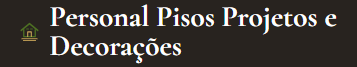

# Personal Pisos

## Integrantes do grupo

| Nome completo                    | RGM      | Usuário no GitHub                                                |
| -------------------------------- | -------- | ---------------------------------------------------------------- |
| Guilherme de Aquino Campos       | 48183989 | [@gaquinocampos](https://github.com/gaquinocampos)               |
| Jhenifer Rosa Cambell            | 47794992 | [@jhenifercambell-hash](https://github.com/jhenifercambell-hash) |
| Julia Lafaelly Frazão Nunes      | 48127507 | [@JuliaLafaelly](https://github.com/JuliaLafaelly)               |
| Marcos Murilo Fernandes da Silva | 48159786 | [@murilomarcoszl](https://github.com/murilomarcoszl) |

## Website hospedado

O website está hospedado no GitHub Pages e pode ser acessado pelo link:

[https://julialafaelly.github.io/Site_Personal_Pisos/]

## Organização escolhida

A organização escolhida para o desenvolvimento do projeto foi a **Personal Pisos**, empresa que atua no segmento de consultoria e decoração de interiores.

A escolha da empresa ocorreu por ser uma organização real, com atuação no mercado de decoração e revestimentos. O grupo registrou informações sobre a história da loja, produtos e serviços, público atendido, diferenciais e formas de contato. O website foi desenvolvido para apresentar a empresa, seus produtos, serviços, formas de contato e possibilidades de orçamento para os clientes.

## Processo de desenvolvimento

O site foi dividido em páginas HTML temáticas, conectadas por uma navegação comum. A página inicial apresenta a empresa e direciona para orçamento, serviços e categorias. Páginas específicas detalham pisos laminados, pisos vinílicos, carpetes e tapetes, papéis de parede, persianas e rodapés. As páginas Sobre, Projetos e Serviços, Contato, Orçamento e Política de Privacidade complementam a experiência.

## Estrutura do website

O projeto foi desenvolvido com páginas HTML interligadas por meio de menus de navegação.

As páginas principais são:

- Página inicial
- Página de contato
- Página de orçamento
- Página sobre a empresa
- Página de pisos laminados
- Página de pisos vinílicos
- Página de carpetes e tapetes
- Página de papéis de parede
- Página de persianas
- Página de rodapés

Cada página apresenta informações relacionadas à organização e possui links para facilitar a navegação entre as demais seções do website.

## Estrutura semântica

Todas as páginas foram desenvolvidas utilizando HTML5 semântico. Foram utilizados elementos como:

- `header`, para o cabeçalho;
- `nav`, para os menus de navegação;
- `main`, para o conteúdo principal;
- `section`, para organizar os blocos de conteúdo;
- `article`, para conteúdos independentes;
- `footer`, para o rodapé;
- `form`, `label`, `fieldset` e `legend`, para a estrutura dos formulários;
- `address`, para as informações de localização e contato.

A utilização desses elementos contribui para melhorar a organização do código, a acessibilidade e a interpretação do conteúdo por navegadores e mecanismos de busca.

## Formulário de contato

O website possui formulários nas páginas de contato e orçamento. Foram utilizados recursos nativos de validação do HTML5, incluindo:

- `required`, para definir campos obrigatórios;
- `type="email"`, para validar endereços de e-mail;
- `type="tel"`, para campos de telefone;
- `pattern`, para definir os formatos aceitos de telefone e CPF;
- `minlength`, para estabelecer a quantidade mínima de caracteres;
- `maxlength`, para limitar o tamanho das informações preenchidas;
- `autocomplete`, para auxiliar o preenchimento dos dados pelo usuário.

Os campos de telefone e CPF possuem máscaras para facilitar a digitação no formato adequado. A validação é realizada pelo próprio navegador, sem a necessidade de bibliotecas externas.

## Estilização com CSS

Todas as páginas utilizam a folha de estilos compartilhada `css/style.css`, que mantém a identidade visual do site. A estilização inclui:

- paleta de cores definida em variáveis CSS;
- tipografia consistente, com Manrope para textos e Cormorant Garamond para títulos;
- componentes visuais padronizados, como botões, cartões, tabelas de especificações e formulários;
- CSS Grid e Flexbox para organizar o conteúdo;
- media queries para adaptar as páginas a diferentes tamanhos de tela.

O CSS está centralizado e reaproveitado entre as páginas. Ainda é possível revisar seletores repetidos em regras responsivas para identificar eventuais redundâncias.


## JavaScript

O arquivo `js/main.js` acrescenta interatividade ao site. Ele é utilizado para:

- controlar os slides/carrosséis da página inicial;
- abrir e fechar o menu de navegação em telas menores e indicar a página atual;
- aplicar máscaras de digitação aos campos de telefone e CPF;
- iniciar animações quando elementos entram na área visível da página;
- preparar mensagens para WhatsApp nos formulários de contato e orçamento, usando `encodeURIComponent`.

O JavaScript complementa a validação nativa do navegador, mas não substitui um serviço de servidor. O site não possui endpoint: os dados não são enviados nem armazenados automaticamente. A pessoa precisa abrir o WhatsApp, revisar a mensagem e tocar em **Enviar**.

## Recursos de áudio e vídeo

O projeto também conta com recursos multimídia para complementar a apresentação da organização e dos seus serviços.

Foi utilizado recurso de vídeo na página institucional da empresa, apresentando informações relacionadas ao trabalho realizado e aos ambientes decorados. Também foi incluído um áudio instrumental aconchegante e original, sem uso de obra de terceiros, na página Sobre.

A inclusão de áudio e vídeo torna o website mais informativo e permite apresentar os serviços de forma mais dinâmica.

## Uso de SVG

Onde utilizamos a imagem SVG no site:



É um símbolo vetorial de uma casa com camadas de piso, usado ao lado do título da primeira coluna do rodapé.

## Pesquisa de referências de leiaute e aparência

Para a pesquisa de referências de leiaute e aparência, foram consultados os três sites indicados pelo grupo:

- [Arquiteto de Bolso](https://arquitetodebolso.com.br/ )
- [Arquiteto Agora](https://arquitetoagora.com.br/ )
- [Wild AG](https://wild-ag.ch/ )

O **Arquiteto de Bolso** apresenta a proposta do serviço logo na abertura da página, destaca resultados e benefícios, explica como funciona em etapas e repete chamadas para ação junto às ofertas. Essa organização serve de referência para apresentar os serviços da Personal Pisos com clareza e facilitar o contato.

O **Arquiteto Agora** organiza a página com orçamento por WhatsApp, apresentação da equipe, exemplos de antes e depois, tipos de projeto, etapas de atendimento, portfólio e depoimentos. Esses elementos ajudam a observar formas de mostrar o trabalho realizado, explicar o processo e transmitir confiança.

O site suíço **Wild AG** foi observado como referência de apresentação institucional. Além da abertura do site ele organiza competências, projetos, equipe, valores e processos em seções identificáveis, além de incluir chamadas para conhecer os projetos e entrar em contato. Essa estrutura ajuda a pensar na hierarquia das informações e na apresentação dos serviços.

As referências foram consultadas para observar organização de conteúdo, hierarquia das seções, apresentação de serviços e portfólio e formas de facilitar o contato. Elas servem como inspiração; o conteúdo, os serviços e a identidade visual da Personal Pisos são próprios, sem reprodução de textos ou marcas desses sites.

## Paleta, tipografia e avaliação visual

O repositório contém as imagens assets/imagens/paleta_antiga.png e assets/imagens/paleta-personal-pisos-lado-a-lado.png, que registram alternativas e comparação de paleta. A folha final mantém os principais tons como variáveis CSS: preto, grafite, marrom, azul-petróleo, verde-escuro, dourado, creme e cinzas. Os tokens permitem ajustar cores de maneira centralizada e manter a identidade visual coerente entre páginas.

A tipografia usa Manrope para textos de interface e corpo e Cormorant Garamond para títulos. As fontes WOFF2 locais são carregadas com @font-face e font-display: swap. A identidade é aplicada aos botões, navegação, cartões, formulários, tabelas de especificação e rodapé.

As imagens de paleta servem como registro visual de comparação.

**Paleta de cores utilizada no site**


**Paleta de cores antiga**


## Testes efetivos 

## Dificuldades encontradas

Durante o desenvolvimento do site, o grupo encontrou desafios relacionados à organização dos arquivos, à navegação entre páginas e à adaptação do layout para diferentes dispositivos.

**Organização dos caminhos**

As páginas internas ficam na pasta `pages/`, enquanto o CSS, o JavaScript e as imagens ficam em outras pastas. Foi necessário configurar caminhos relativos diferentes para que os arquivos fossem carregados corretamente em cada página.

**Versionamento com GitHub**

O grupo teve dificuldades para utilizar o GitHub e organizar o versionamento dos arquivos. Foi necessário aprender a acompanhar as alterações e manter os arquivos do projeto atualizados no repositório.

**Padronização visual**

Como o site possui várias páginas e categorias, foi necessário manter uma identidade visual consistente entre elas. A folha de estilos compartilhada ajudou a padronizar cores, tipografia, botões, cartões, tabelas e formulários.

**Layout responsivo**

Foi necessário organizar os elementos para que o conteúdo funcionasse em diferentes tamanhos de tela. O uso de CSS Grid, Flexbox e media queries ajudou a adaptar menus, cartões, formulários e outras seções.

**Imagens e desempenho**

Algumas imagens originais eram grandes e poderiam deixar o carregamento mais lento, principalmente em celulares. Para reduzir esse impacto, foram criadas versões WebP menores, mantidos fallbacks JPEG/PNG e configurado o carregamento tardio de imagens que ficam abaixo da primeira área visível.

**Formulários e contato**

Foi necessário conectar a ação dos formulários ao fluxo de atendimento da loja. Como o site está hospedado como página estática e não possui um endpoint de servidor, o envio foi direcionado ao WhatsApp. A pessoa ainda precisa abrir o aplicativo, revisar a mensagem e enviá-la; os dados não são armazenados automaticamente pelo site.

Esses desafios ajudaram o grupo a compreender a importância de testar caminhos, navegação, aparência em diferentes dispositivos e funcionamento dos recursos antes da publicação.

## Validação no W3C

Todos os arquivos HTML foram submetidos ao W3C Nu HTML Checker.

Após as correções realizadas na estrutura do código, as páginas foram validadas e não apresentaram erros relevantes no W3C Validator.

**Validador utilizado:** [W3C Nu HTML Checker](https://validator.w3.org/nu/)

## Como seria o processo de obter o mesmo resultado (ou equivalente) se o website fosse desenvolvido com IA

Para criar um site equivalente com apoio de IA, o grupo começaria reunindo informações verificadas sobre a empresa: história, produtos, serviços, público, diferenciais, contatos e identidade visual. Também definiria os objetivos do site, as páginas necessárias e os recursos que a hospedagem precisa suportar.

Em seguida, a IA poderia ajudar a:

1. **Planejar o conteúdo:** organizar as informações em um mapa de páginas e propor a estrutura de cada seção.
2. **Escrever rascunhos:** preparar textos para a página inicial, as categorias de produtos, a apresentação da empresa e os formulários.
3. **Criar a estrutura HTML:** gerar páginas semânticas, com navegação, títulos, imagens, formulários e links entre as páginas.
4. **Preparar o CSS:** sugerir paleta, tipografia, componentes compartilhados e layout responsivo com Grid, Flexbox e media queries.
5. **Adicionar JavaScript:** implementar interações, como menu móvel, carrossel, máscaras de campos e abertura de uma mensagem de WhatsApp.
6. **Revisar e testar:** ajudar a procurar erros de código, links quebrados, problemas de acessibilidade e oportunidades de otimização.

O grupo precisaria fornecer à IA dados reais, imagens autorizadas, logotipo, preferências visuais e requisitos do projeto. Depois, deveria revisar o conteúdo e o código, comparar o resultado com o objetivo definido e testar as páginas em diferentes navegadores e tamanhos de tela. Também seria necessário confirmar que formulários, imagens, links e recursos funcionam na hospedagem escolhida.

A IA pode acelerar a criação de rascunhos e sugerir soluções, mas não deve ser tratada como fonte única de informação. O grupo continua responsável por confirmar os dados da empresa, verificar direitos de uso dos materiais, testar o site e corrigir eventuais erros antes da publicação.```


## Contato com o responsável pela organização

O contato com o responsável pela Personal Pisos e Carpetes foi realizado por meio de:

- **Modalidade do contato:** Presencial
- **Data:** 22/08/2026
- **Responsável entrevistado:** Jonatan Nunes/Grazielle Nunes (Dono da Empresa)
- **Participantes do grupo:** Guilheme Campos, Jhenifer Rosa, Julia Lafaelly e Marcos Murilo

Durante o contato, foram coletadas informações sobre a história da empresa, os principais produtos e serviços oferecidos, o público atendido, os diferenciais da organização e as necessidades que o website deveria apresentar.

A conversa também ajudou o grupo a compreender melhor a identidade da empresa e a organizar os conteúdos das páginas desenvolvidas.

## Comprovação do contato

**Imagem da comprovação:**


## Conclusão

A primeira etapa do projeto permitiu ao grupo desenvolver a base estrutural de um website utilizando HTML5, sem depender de estilização visual ou recursos avançados de CSS.

Durante o desenvolvimento, aprendemos a organizar páginas com elementos semânticos, criar menus de navegação, estruturar formulários, utilizar validações nativas do HTML5 e inserir recursos multimídia de áudio e vídeo.

Também compreendemos a importância de desenvolver um projeto baseado em uma organização real, pois o contato com o responsável contribuiu para tornar o conteúdo mais coerente com as características e necessidades da empresa.

A validação no W3C ajudou o grupo a identificar e corrigir problemas no código, reforçando a importância de seguir os padrões da web e utilizar uma estrutura HTML organizada, acessível e válida.
